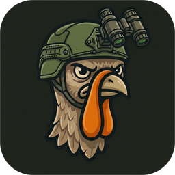
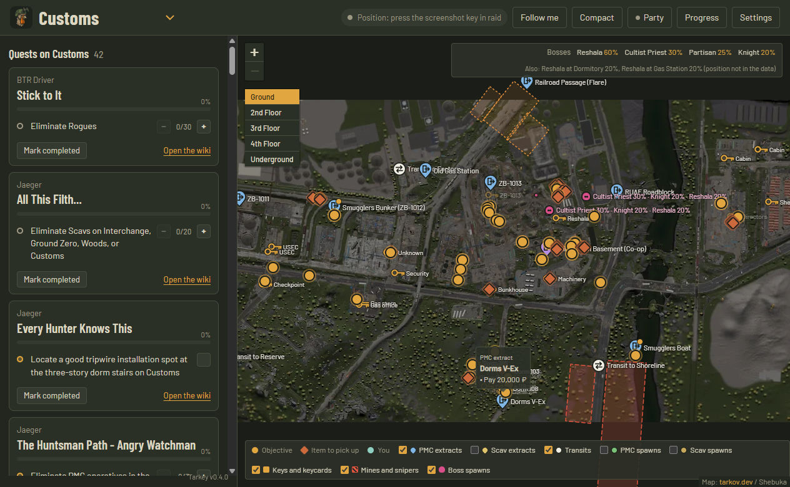
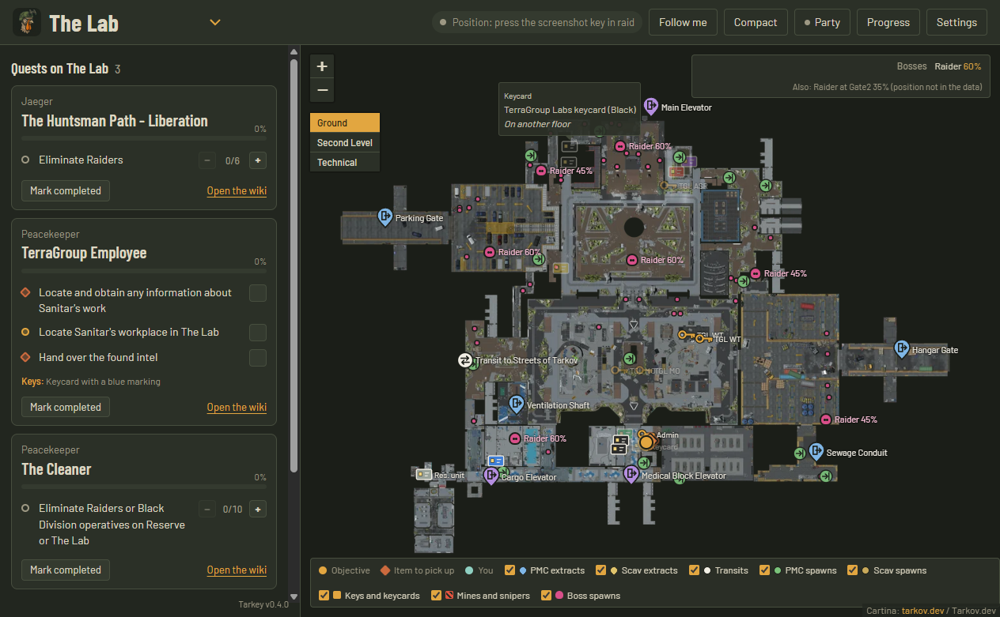
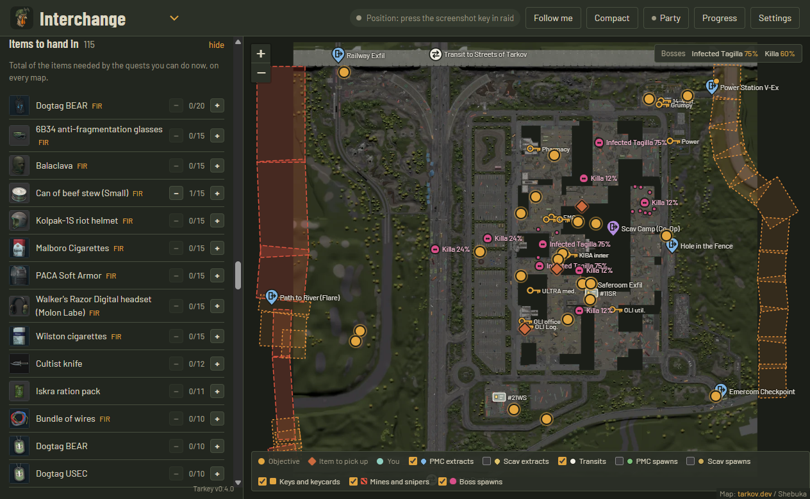

  

<h1 align="center">Tarkey</h1>

  <b>A second-screen companion for Escape from Tarkov.</b> 
  Your quests, extracts, keys and squad on one live map, without touching the game.

  <a href="https://github.com/xtango92x/tarkey-releases/releases/latest"><b>⬇ Download the latest version</b></a>
  &nbsp;·&nbsp; Windows 10/11 &nbsp;·&nbsp; Free &nbsp;·&nbsp; English / Italiano

## What it does

- **Quests for the map you're on.** It shows only the quests you can actually do right now, based on your level, faction and finished quests. Each objective is a marker on the map. Click an objective to jump to it, and track progress with − / +.
- **Live position.** Press the in-game screenshot key and your arrow shows up on the map, pointing where you look. The arrow goes from green to red as the position gets older.
- **Map detected automatically.** When a raid starts, Tarkey switches to the right map by itself, PMC or Scav.
- **Quests tick themselves.** Finished quests are read from the game logs. You can also import your history in one click.
- **Extracts and transits.** PMC, Scav and co-op extracts with their names. Hover an extract to see what it needs, like *Pay 20,000 ₽* or a specific item.
- **Keys and keycards.** Every locked door with the key or keycard that opens it. Labs keycards use their real color.
- **Bosses, mines and snipers.** Boss spawn points with chances, minefields and Scav sniper zones.
- **PMC and Scav spawns.** You can switch them on to see where you can start the raid.
- **Building floors.** On multi-level maps the right floor comes up by itself.
- **Items to hand in and Hideout.** Every item your quests and Hideout upgrades need, with a counter for how many you already have.
- **Price check.** Type an item name to see the flea price and the trader that pays the most.
- **Squad mode.** Friends with the same party code see each other on the map, can drop markers like *Enemy here* or *Going here*, and see the quests they have in common. No accounts needed, and positions are encrypted with the party code.
- **Compact mode.** A small always-on-top map window, for borderless-windowed play.
- **Auto-updates.** New versions download by themselves. You can turn this off in Settings so a download never slows down your raid.

## Is it safe? Will I get banned?

Tarkey **never touches the game**. It doesn't read game memory, inject anything, send keys or talk to the game servers.
It only reads two kinds of files that the game writes to disk by itself:

- **screenshots**: the position is in the file name;
- **log files**: the current map and quests you finish.

That's the same information you'd get by looking at those files yourself. Don't use macros to press the screenshot key automatically.

## Install

1. Download `Tarkey-Setup-x.y.z.exe` from [Releases](https://github.com/xtango92x/tarkey-releases/releases/latest).
2. Run it. Windows may show a blue *"Windows protected your PC"* box, because the app isn't signed with a paid certificate.
   Click **More info → Run anyway**.
3. In **Settings**, set your PMC level, faction and mode (PvP or PvE), and check the screenshot and game folders. They're usually found automatically.
4. In **Progress**, press **Import from Tarkov logs** to mark the quests you've already done.
5. In raid, press the screenshot key, `Print Screen` by default, to update your position.

From then on, Tarkey updates itself.

## Squad mode

1. One of you opens **Party**, ticks **Enable party**, writes a name, presses **New** and **Save**.
2. Send the code to your friends. They paste it in their **Party** window and press **Save**.
3. Everyone gets a different arrow color: pick yours in **Settings**.

Positions go through free public MQTT servers and are encrypted with a key made from the party code.
Without the code, nobody can read them. Treat the code like a password.

---

## In italiano

**Tarkey** è un'app da secondo schermo per Escape from Tarkov:
- missioni della mappa su cui sei, con gli obiettivi sulla cartina;
- uscite con i requisiti, chiavi e tessere, boss, mine e cecchini;
- la tua posizione col tasto screenshot;
- il party con gli amici;
- gli oggetti da consegnare per missioni e Rifugio.

**Non tocca mai il gioco**: legge solo gli screenshot e i file di log che Tarkov salva sul disco.

**Installazione:**
1. Scarica `Tarkey-Setup-x.y.z.exe` da [Releases](https://github.com/xtango92x/tarkey-releases/releases/latest) e aprilo.
2. Se compare l'avviso blu di Windows, premi **Ulteriori informazioni → Esegui comunque**.
3. In **Settings → Language** scegli **Italiano**.

---

Tarkey is a fan-made tool and is not affiliated with or endorsed by Battlestate Games.
Escape from Tarkov is a trademark of Battlestate Games Limited.
Map images, quest and item data come from <a href="https://tarkov.dev">tarkov.dev</a>.
