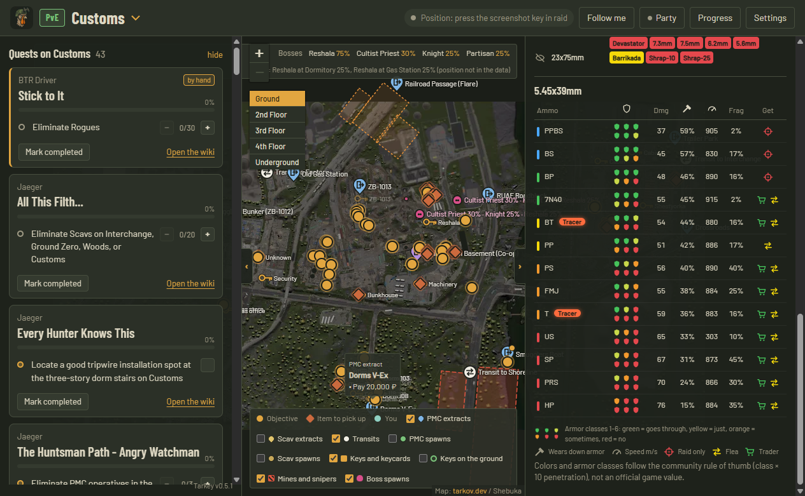
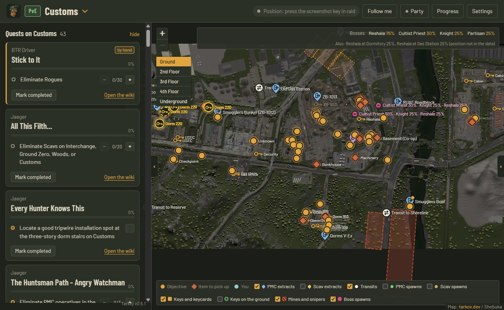

  

<h1 align="center">Tarkey</h1>

  <b>A second-screen companion for Escape from Tarkov.</b> 
  Your quests, extracts, keys and squad on one live map, without touching the game.

  <a href="https://github.com/xtango92x/tarkey-releases/releases/latest"><b>⬇ Download the latest version</b></a>
  &nbsp;·&nbsp; Windows 10/11 &nbsp;·&nbsp; Free &nbsp;·&nbsp; English / Italiano

## What it does

**On the map**
- **Full-screen live map** with two side columns you can fold away: quests and items on the left, prices and ammo on the right.
- **Live position.** Press the in-game screenshot key and your arrow shows up on the map, pointing where you look. The arrow goes from green to red as the position gets older.
- **Map detected automatically.** When a raid starts, Tarkey switches to the right map by itself, PMC or Scav.
- **Extracts and transits.** PMC, Scav and co-op extracts with their names. Hover an extract to see what it needs, like *Pay 20,000 ₽* or a specific item.
- **Keys and keycards.** Every locked door with the key or keycard that opens it. Labs keycards use their real color, ⚡ marks doors that need power.
- **Where to find keys.** Click a door and the fixed spots where its key lies on the ground light up on the map, floor included.
- **Bosses, mines and snipers.** Boss spawn points with chances, minefields and Scav sniper zones.
- **PMC and Scav spawns**, and **building floors** that switch by themselves as you move.

**Quests and items**
- **Quests for the map you're on**, only the ones you can actually do now, with every objective as a marker and progress you track with − / +.
- **Quests tick themselves.** Completed and failed quests are read from the game logs, live or in one click for your whole history. Lightkeeper and BTR Driver quests, which the game never logs, are clearly marked as *by hand*.
- **Items to hand in and Hideout**, with a counter for how many you already have.

**Prices and ammo**
- **Price check.** Lowest and average flea price, the cheapest trader to buy from and the best one to sell to, with the best option highlighted. PvE and PvP are separate markets.
- **Ammo chart.** Every caliber with its rounds named as in the game (PPBS, BS, M995…), colored from *top* to *leave it*, so you know at a glance what to pick up. Hide calibers or colors you don't care about. Open a caliber for penetration (6 armor-class shields), damage, armor damage, speed, fragmentation, tracers and where to get it: raid only, trader, or flea as a pack.

**Squad and the rest**
- **Squad mode.** Friends with the same party code see each other on the map, can drop markers like *Enemy here* or *Going here*, and see the quests they have in common. No accounts needed, and positions are encrypted with the party code.
- **PvE / PvP** badge always visible: click it for Settings, hold it to switch mode and reload everything.
- **Auto-updates** with a progress bar. You can turn automatic downloads off so an update never slows down your raid.

## Is it safe? Will I get banned?

Tarkey **never touches the game**. It doesn't read game memory, inject anything, send keys or talk to the game servers.
It only reads two kinds of files that the game writes to disk by itself:

- **screenshots**: the position is in the file name;
- **log files**: the current map and quests you finish.

That's the same information you'd get by looking at those files yourself. Don't use macros to press the screenshot key automatically.

## Install

1. Download `Tarkey-Setup-x.y.z.exe` from [Releases](https://github.com/xtango92x/tarkey-releases/releases/latest).
2. Run it. Windows may show a blue *"Windows protected your PC"* box, because the app isn't signed with a paid certificate.
   Click **More info → Run anyway**.
3. In **Settings**, set your PMC level, faction and mode (PvP or PvE), and check the screenshot and game folders. They're usually found automatically.
4. In **Progress**, press **Import from Tarkov logs** to mark the quests you've already done.
5. In raid, press the screenshot key, `Print Screen` by default, to update your position.

From then on, Tarkey updates itself.

## Squad mode

1. One of you opens **Party**, ticks **Enable party**, writes a name, presses **New** and **Save**.
2. Send the code to your friends. They paste it in their **Party** window and press **Save**.
3. Everyone gets a different arrow color: pick yours in **Settings**.

Positions go through free public MQTT servers and are encrypted with a key made from the party code.
Without the code, nobody can read them. Treat the code like a password.

---

## In italiano

**Tarkey** è un'app da secondo schermo per Escape from Tarkov:
- missioni della mappa su cui sei, con gli obiettivi sulla cartina;
- uscite con i requisiti, chiavi e tessere (e dove trovare le chiavi a terra), boss, mine e cecchini;
- la tua posizione col tasto screenshot;
- il party con gli amici;
- gli oggetti da consegnare per missioni e Rifugio;
- prezzi del mercato e dei mercanti, separati per PvE e PvP;
- la tabella delle munizioni, colorate da "top" a "da lasciare", per capire al volo cosa raccogliere.

**Non tocca mai il gioco**: legge solo gli screenshot e i file di log che Tarkov salva sul disco.

**Installazione:**
1. Scarica `Tarkey-Setup-x.y.z.exe` da [Releases](https://github.com/xtango92x/tarkey-releases/releases/latest) e aprilo.
2. Se compare l'avviso blu di Windows, premi **Ulteriori informazioni → Esegui comunque**.
3. In **Settings → Language** scegli **Italiano**.

---

Tarkey is a fan-made tool and is not affiliated with or endorsed by Battlestate Games.
Escape from Tarkov is a trademark of Battlestate Games Limited.
Map images, quest and item data come from <a href="https://tarkov.dev">tarkov.dev</a>.
